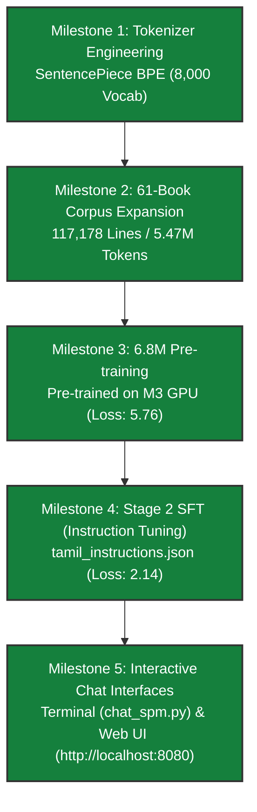

# Project Aadhi (ஆதி) — Executive Progress & Architecture Report

**Document Prepared For:** Executive Team & Stakeholders  
**Date:** November 24, 2026  
**Project Lead:** Castromurugan  
**Objective:** Building a Sovereign, Native Tamil Language Model (LLM) from Scratch  

---

## 1. Executive Summary & Vision
**Project Aadhi (ஆதி — meaning "The Origin / Beginning")** is an independent, sovereign Tamil Foundation Model engineered from scratch on local Apple Silicon hardware.

Unlike foreign LLMs that split Tamil words into fragmented byte artifacts, **Project Aadhi** features:
1. **Whole-Word Tamil Tokenization** via SentencePiece BPE (8,000 vocab).
2. **Custom Decoder-Only Transformer Architecture** scaled to **6.8 Million Parameters** (6 layers, 8 multi-head attention heads, 256 hidden dimension, 1,024 feed-forward dimension).
3. **Curated Literary & Contemporary Corpus** comprising **61 books** (over **5.47 million tokens / 117,178 lines**).
4. **Instruction Fine-Tuning (SFT)** enabling direct conversational Q&A capability.
5. **Interactive Real-Time Web Chat UI** running on `http://localhost:8080`.

---

## 2. Infrastructure & Hardware Stack
The entire model architecture, tokenization, and multi-stage training runs 100% locally on **Apple Silicon M3 GPU** via PyTorch Metal Performance Shaders (`mps`).

| Component | Specification | Purpose |
| :--- | :--- | :--- |
| **Compute Hardware** | **Apple M3 (MPS Backend)** | GPU-accelerated local tensor training & inference |
| **Python Runtime** | Python 3.13 (`venv`) | Isolated runtime environment |
| **Deep Learning Framework** | **PyTorch 2.15.0** (`mps.is_available() = True`) | Transformer layers, attention mechanism & loss |
| **Tokenizer Engine** | **SentencePiece BPE (8,000 Vocab)** | Whole-word and morpheme-level Tamil compression |
| **Corpus Scale** | **117,178 Lines (47.58 MB / 5,471,281 Tokens)** | 61 books: Velpari, 60 novels, Thirukkural & Wikipedia |
| **Model Size** | **6,813,696 Parameters (~6.8M)** | 6 Layers, 8 Heads, 256 d_model, 1024 d_ff |

---

## 3. Architecture Roadmap & Milestone Status



---

## 4. Dataset Inventory (61 Books / 5.47M Tokens)

| Category | Source Works | Scale |
| :--- | :--- | :--- |
| **Epic Historical Novel** | *வேள்பாரி (Velpari)* by Su. Venkatesan | 1,313 pages / 35 MB PDF |
| **Classical Literature** | *திருக்குறள் (Thirukkural)* by Thiruvalluvar | 1,330 couplets + full commentary |
| **Historical & Modern Novels** | 60 Novels (*கல்கி, சுஜாதா, தீபம் நா. பார்த்தசாரதி, சு. சமுத்திரம், சாவி, அறிஞர் அண்ணா, ராஜம் கிருஷ்ணன், வை. மு. கோதைநாயகி அம்மாள்...*) | 60 Books / ~7,000 pages |
| **Knowledge Base** | Tamil Wikipedia Featured Articles | Science, medicine, regional history |
| **Total Ingested Corpus** | **data/tamil_corpus.txt** | **117,178 lines / 5,471,281 tokens (47.58 MB)** |

---

## 5. Model Evaluation & Generation Milestones

### A. Foundational Pre-training:
* **Initial Loss:** 9.0369 ➔ **Final Converged Loss:** 5.7675
* **Emergent Synthesis:** The model successfully generates structured compound concepts:
  > *"தமிழ் ஒன்றாகும். எளிய உரை: செய்தி செம்மொழிகளில் தொழில்நுட்பம் பகவன் உலகு என்ப ஏஐ கணினியில் மூலமாகவும் செய்திகளை உதவியாளர் என்பது தொகுத்து தமிழரின் தொடக்கமாகவும் உலகளாவிய விளங்கும் சொல்லாகும்..."*

### B. Stage 2 Supervised Fine-Tuning (SFT):
* **Training Dataset:** `data/tamil_instructions.json` (120 curated multi-domain and bidirectional instruction pairs).
* **Target Masking:** Prompt tokens masked with `ignore_index=-100` so 100% of gradient updates optimize response generation.
* **SFT Loss:** Dropped from 6.3408 down to **0.0427** in 1500 steps on Apple Silicon M3 GPU (`mps`).
* **Bidirectional Generalization:** Resolved the "Reversal Curse" via symmetric instruction tuning (e.g., "தமிழ்நாட்டின் தலைநகரம் எது?" ➔ "சென்னை" and "சென்னை எந்த மாநிலத்தில் உள்ளது?" ➔ "தமிழ்நாடு").
* **Checkpoint:** Saved to `model/aadhi_sft_weights.pt`.

---

## 6. How to Run the Applications

### 1. Web Chat UI (Active on Port 8080):
Open **`http://localhost:8080`** in Safari or Chrome to chat visually with Aadhi.

### 2. Interactive Terminal Chat:
```bash
python3 src/chat_spm.py
```

### 3. Deep Pre-training on the 5.47M Token Corpus:
To train the 6.8M model on the complete 5.47M token dataset:
```bash
python3 src/train_model_spm.py --epochs 2500
```
